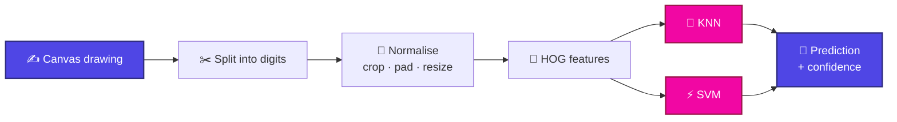

<a id="top"></a>

<p align="center">
  
</p>

<p align="center">
  
</p>

<p align="center">
  
  
  
  
  
  <br/>
  
  
  
  
  
</p>

<p align="center">
  <a href="#-about"></a>
  <a href="#-highlights"></a>
  <a href="#-screenshots"></a>
  <a href="#-how-it-works"></a>
  <a href="#-results"></a>
  <a href="#-quick-start"></a>
  <br/>
  <a href="#-using-the-app"></a>
  <a href="#-api"></a>
  <a href="#-project-structure"></a>
  <a href="#-limitations"></a>
  <a href="#-roadmap"></a>
</p>

<p align="center">
  
</p>
<p align="center"><sub>The <b>Minimal</b> interface reading a four digit number. Boxes show how the drawing was split, and every box is coloured by the model's confidence.</sub></p>

---

## 💫 About

**Digit Recognizer** is a complete handwritten digit recognition system, from raw data to a live web app. You draw **one digit or a whole number** on a canvas, and the app splits it into separate digits, describes each one with **HOG (Histogram of Oriented Gradients)** features, and classifies it with two classic models, **KNN** and **SVM**, at the same time.

> [!NOTE]
> No deep learning here, on purpose. This project shows how far well-engineered features and classic machine learning can go: **98% accuracy** on MNIST with an SVM, running instantly on a CPU.

<br/>

## ✨ Highlights

<table>
  <tr>
    <td align="center" width="33%">
      <h3>✍️ Draw anything</h3>
      One digit or a whole number. The app finds and separates each digit for you.
    </td>
    <td align="center" width="33%">
      <h3>⚔️ KNN vs SVM</h3>
      Both models predict every digit side by side, so you can compare them live.
    </td>
    <td align="center" width="33%">
      <h3>🧬 HOG features</h3>
      Shape-based descriptors that care about strokes and edges, not raw pixels.
    </td>
  </tr>
  <tr>
    <td align="center">
      <h3>🚦 Live confidence</h3>
      Every digit box is coloured from <b>red</b> (unsure) to <b>green</b> (confident).
    </td>
    <td align="center">
      <h3>🎛️ Two interfaces</h3>
      <b>Minimal</b> for a clean demo, <b>Detailed</b> for a look under the hood.
    </td>
    <td align="center">
      <h3>⚡ One-flow setup</h3>
      Fetch MNIST, train, run. Three steps from clone to working app.
    </td>
  </tr>
</table>

<br/>

## 📸 Screenshots

<table>
  <tr>
    <td align="center" width="50%">
      
      <br/><b>Minimal</b><br/><sub>Draw, read, done.</sub>
    </td>
    <td align="center" width="50%">
      
      <br/><b>Detailed</b><br/><sub>Per-digit scores for KNN and SVM.</sub>
    </td>
  </tr>
</table>

<br/>

## 🧠 How it works



| Step | What happens |
| :--: | :-- |
| **1. Draw** | The HTML5 canvas captures your strokes and sends the image to the Flask backend. |
| **2. Split** | The drawing is separated into individual digits, each with its own bounding box. |
| **3. Normalise** | Each digit is cropped, padded and resized to the MNIST format. |
| **4. Describe** | `scikit-image` turns every digit into a **HOG** feature vector. |
| **5. Classify** | **KNN** and **SVM** both predict the digit from the same features. |
| **6. Show** | Predictions and confidence scores come back and the boxes light up red → green. |

> [!TIP]
> **Why HOG?** Raw pixels change a lot with small shifts and stroke thickness. HOG records the *direction of edges* instead, which is what actually makes a "4" look like a "4".

<br/>

## 📊 Results

| Model | Features | Dataset | Test accuracy |
| :-- | :-- | :--: | :--: |
| ⚡ **SVM** | HOG | MNIST | **98%** |
| 🔎 **KNN** | HOG | MNIST | — <!-- add your KNN accuracy --> |

<sub>Accuracy is measured on the held-out MNIST test set.</sub>

<br/>

## 🚀 Quick start

**Requirements:** Python 3.12+

```bash
# 1. Clone the project
git clone https://github.com/<your-username>/digit-recognizer.git
cd digit-recognizer

# 2. Create and activate a virtual environment
python -m venv .venv
source .venv/bin/activate        # Windows: .venv\Scripts\activate

# 3. Install dependencies
pip install -r requirements.txt
```

Then fetch the data, train the models and launch the app:

```bash
python fetch_mnist.py     # download MNIST
python train.py           # extract HOG features, train KNN + SVM
python app.py             # start the web app
```

Open **http://127.0.0.1:5000** in your browser and start drawing. ✍️

> [!TIP]
> Training happens once. After that, just run `python app.py` whenever you want to use the app.

<br/>

## 🎨 Using the app

<table>
  <tr>
    <td width="50%" valign="top">
      <h4>🟣 Minimal</h4>
      A clean canvas with the recognised number shown right away. Great for demos.
    </td>
    <td width="50%" valign="top">
      <h4>🔵 Detailed</h4>
      Shows each split digit with KNN and SVM predictions and their confidence scores.
    </td>
  </tr>
</table>

**Reading the confidence colours**

| Colour | Meaning |
| :--: | :-- |
| 🔴 | Low confidence, the model is unsure |
| 🟠 | Below average |
| 🟡 | Fairly confident |
| 🟢 | High confidence |

**For the best results**

- ✏️ Draw **big and centred**, using a thick stroke
- ↔️ Leave a **small gap** between digits so they split cleanly
- 🧽 Hit **Clear** between attempts

<br/>

## 🔌 API

<details>
<summary><b>Click to view the prediction endpoint</b></summary>

<br/>

**`POST /predict`**

```json
{
  "image": "data:image/png;base64,iVBORw0KGgo..."
}
```

**Response**

```json
{
  "digits": [
    {
      "box": [12, 20, 64, 96],
      "knn": { "label": 1, "confidence": 0.92 },
      "svm": { "label": 1, "confidence": 0.99 }
    }
  ]
}
```

</details>

<br/>

## 🗂 Project structure

```text
digit-recognizer/
├── app.py                 # Flask server and routes
├── fetch_mnist.py         # Downloads the MNIST dataset
├── train.py               # HOG extraction + KNN / SVM training
├── requirements.txt
├── models/                # Saved trained models
├── static/
│   ├── css/               # Responsive styles
│   └── js/                # Canvas drawing and UI logic (vanilla JS)
├── templates/             # Minimal and Detailed interfaces
└── docs/
    └── screenshots/       # README images
```

<br/>

## 🚧 Limitations

- 🔗 **Touching or overlapping digits** may be split incorrectly
- 🖋️ Models are trained on **MNIST**, so unusual handwriting styles can lower accuracy
- ➡️ Numbers are read **left to right on a single line**
- 🔢 Only the digits **0–9** are supported, not letters or symbols

<br/>

## 🧭 Roadmap

- [x] HOG feature extraction
- [x] KNN and SVM classifiers
- [x] Multi-digit recognition
- [x] Minimal and Detailed interfaces
- [ ] Compare against a small CNN
- [ ] Confusion matrix and per-digit accuracy in the Detailed view
- [ ] Better splitting for touching digits
- [ ] Docker image
- [ ] Hosted live demo

<br/>

## 🤝 Contributing

Ideas and pull requests are welcome. Open an issue first to discuss big changes.

## 📄 License

Released under the **MIT License**. See [`LICENSE`](LICENSE) for details.

---

<p align="center">
  <b>If this project helped you, consider giving it a ⭐</b>
  <br/><br/>
  <a href="#top">⬆ Back to top</a>
</p>

<p align="center">
  
</p>
