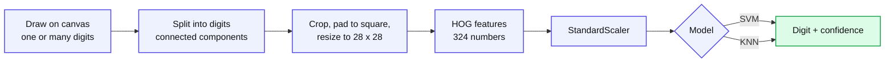
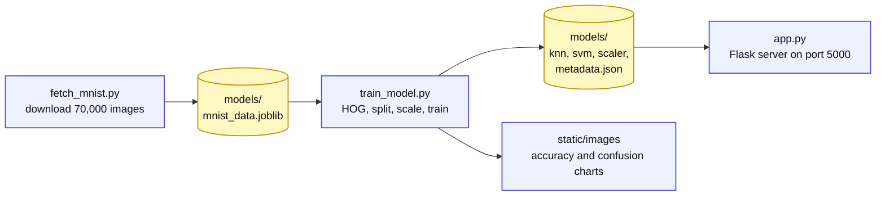
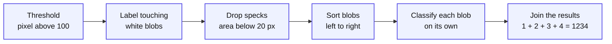

<p align="center">
  
</p>

<p align="center">
  
</p>

<p align="center">
  
  
  
  
  
  <br/>
  
  
  
  
  
</p>

<p align="center">
  <a href="#-about">About</a> •
  <a href="#-highlights">Highlights</a> •
  <a href="#-screenshots">Screenshots</a> •
  <a href="#-how-it-works">How it works</a> •
  <a href="#-results">Results</a> •
  <a href="#-quick-start">Quick start</a> •
  <a href="#-using-the-app">Using the app</a> •
  <a href="#-api">API</a> •
  <a href="#-project-structure">Structure</a> •
  <a href="#-limitations">Limitations</a> •
  <a href="#-roadmap">Roadmap</a>
</p>

<p align="center">
  
</p>

<p align="center"><sub>The Minimal interface reading a four digit number. Boxes show how the drawing was split, and every box is coloured by the model's confidence.</sub></p>

---

## 💫 About

**Digit Recognizer** is a complete handwritten digit recognition system, from raw data to a live web app. You draw **one digit or a whole number** on a canvas, and the app splits it into separate digits, describes each one with **HOG (Histogram of Oriented Gradients)** features, and classifies it with two classic models, **KNN** and **SVM**, at the same time.

Everything the app needs is **built by the code itself**. No dataset and no trained model is stored in this repository: one script downloads MNIST, another trains the models, and then the server runs.

<table align="center">
  <tr>
    <td align="center"><h2>98.06%</h2><sub>SVM accuracy<br/>(8,000 unseen test images)</sub></td>
    <td align="center"><h2>95.69%</h2><sub>KNN accuracy<br/>(same test images)</sub></td>
    <td align="center"><h2>324</h2><sub>HOG features<br/>per digit (from 784 pixels)</sub></td>
    <td align="center"><h2>40,000</h2><sub>MNIST images used<br/>32,000 train / 8,000 test</sub></td>
  </tr>
</table>

---

## ✨ Highlights

| | Feature | What it gives you |
|:--:|:--|:--|
| ✍️ | **Multi-digit input** | Draw a whole number. Digits are separated automatically with connected-component analysis and read left to right. |
| 🧭 | **HOG feature extraction** | Digits are described by stroke direction (9 bins, 7x7 cells, 2x2 blocks), not by raw pixels. |
| ⚔️ | **KNN vs SVM, live** | Both models run on every drawing. The app shows the answer of the selected model and tells you whether the other one agrees. |
| 🚦 | **Colour-coded confidence** | Every digit gets a confidence score, coloured from red (low) through yellow to green (high). |
| 🔲 | **See how it split your drawing** | Boxes are drawn on the canvas around each detected digit, next to the cropped 28x28 image the model really sees. |
| 🔀 | **Two interfaces, one click** | A **Minimal** UI (default) and a **Detailed** UI with HOG maps, metrics and a dataset gallery. Switch from the top-right corner. |
| ⌨️ | **Comfortable drawing** | Wide canvas, undo, clear, keyboard shortcuts, optional auto-analyze, mouse and touch support. |
| 🧪 | **Reproducible pipeline** | `fetch_mnist.py` then `train_model.py` then `app.py`. Models are never committed. |

---

## 🖼️ Screenshots

### Minimal interface (opens by default)

Clean white workspace. One card per detected digit shows the cropped image, the prediction, its confidence and what the other model said.

<p align="center">
  
</p>

### Uncertainty is visible

The last digit below is a thin, straight **7** that both models read as a **1**. The model is not sure, so that digit gets a **yellow** box and a **70%** score, which tells you to double-check it.

<p align="center">
  
</p>

### Detailed interface

Everything the model does, laid out: intensity maps, HOG maps, all 10 confidence bars per digit, training metrics, a dataset gallery and training charts.

<p align="center">
  
</p>

<sub>Screenshots are taken from the running app. The digits were drawn by a script that replays pointer strokes.</sub>

---

## 🧠 How it works

### 1. From drawing to answer



### 2. From nothing to a trained model



### 3. Why HOG?

HOG ignores brightness and records **which direction the strokes go**: a `1` is mostly vertical, a `7` has a horizontal bar and a diagonal, a `0` curves all the way around.

| Step | Setting in this project | Result |
|:--|:--|:--|
| Gradients | change in brightness left/right and up/down | edge strength and direction per pixel |
| Orientation bins | 9 bins, 20 degrees each (0 to 180) | each pixel votes into one direction |
| Cells | 7x7 pixels, so a 4x4 grid | 16 cells x 9 bins = 144 numbers |
| Blocks | 2x2 cells, sliding by one cell (9 blocks), L2-Hys normalised | contrast robust, overlapping |
| Feature vector | 9 blocks x 4 cells x 9 bins | **324 numbers** instead of 784 pixels |

> **A measured note.** On clean, perfectly centred MNIST images, raw pixels reach about the same accuracy as HOG (SVM 98.4% vs 98.2% in a one-off comparison on the same split). The benefit of HOG is **robustness and speed**: when the test digits were shifted by 2 pixels, a raw-pixel SVM fell to 51.6% while the HOG SVM kept 85.0%, and HOG trained the SVM about 3.7x faster. That matters for hand-drawn input.

### 4. KNN and SVM

| | **KNN** | **SVM** |
|:--|:--|:--|
| Idea | The 3 most similar training digits vote | A curved boundary with the widest possible margin between digits |
| Settings | `k=3`, Euclidean distance, `weights="distance"` | RBF kernel, `C=10`, `gamma="scale"` |
| Learns | Nothing, it stores the 32,000 training vectors | About 7.8k support vectors (the hardest border examples) |
| Multi-class | Direct vote | 45 one-vs-one classifiers, then voting |
| Confidence | Share of the distance-weighted vote | Platt scaling plus pairwise coupling |
| Training | Instant | Slower (also calibrates probabilities) |
| Strength | Simple and easy to explain | More accurate, graded confidence, smaller model |

### 5. Reading several digits



There is no line drawn between digits: each digit is a separate blob of white pixels, and the box around it is its bounding box. **Leave a small gap between digits** and do not let them touch.

### 6. The confidence colour scale

| Confidence | Colour | Meaning |
|:--|:--:|:--|
| 40% or lower | 🟥 Red | The model is unsure, check this digit |
| about 70% | 🟨 Yellow | Doubtful |
| 95% or higher | 🟩 Green | Very reliable |

Values in between blend smoothly. The scale is fixed, so red really means low confidence: if every digit is sure, every digit is green.

---

## 📊 Results

Measured on **8,000 MNIST images the models never saw** during training.

| Model | Accuracy | Precision | Recall | F1 | Mistakes |
|:--|:--:|:--:|:--:|:--:|:--:|
| **SVM** (RBF, C=10) | **98.06%** | 0.981 | 0.981 | 0.981 | 155 |
| **KNN** (k=3) | 95.69% | 0.958 | 0.957 | 0.957 | 345 |

SVM makes about **55% fewer mistakes** than KNN. The biggest difference is on look-alike digits: KNN turned 55 test fours into nines, SVM only 10.

<p align="center">
  
</p>

<details>
<summary><b>Recall per digit (click to expand)</b></summary>

| Digit | 0 | 1 | 2 | 3 | 4 | 5 | 6 | 7 | 8 | 9 |
|:--|:--:|:--:|:--:|:--:|:--:|:--:|:--:|:--:|:--:|:--:|
| **SVM** | 98.7 | 98.9 | 98.9 | 97.3 | 97.7 | 98.9 | 98.4 | 97.3 | 97.6 | 97.0 |
| **KNN** | 98.7 | 97.7 | 94.4 | 95.7 | 91.6 | 94.0 | 99.0 | 94.5 | 94.6 | 96.5 |

Values are percentages from one training run. The 40,000 images are sampled randomly each time you train, so your numbers will differ a little.
</details>

**Confidence is meaningful.** On images not used for training, SVM predictions with confidence above 99.995% were right 100% of the time, while predictions between 50% and 70% were right about 69% of the time. KNN confidence is coarser: it shows exactly 100% for most answers, and about 1% of those are still wrong.

---

## 🚀 Quick start

> Nothing to download by hand. The dataset is fetched by the code and the models are trained by the code.

**1. Clone and create an environment**

```bash
git clone https://github.com/<your-username>/<your-repo>.git
cd <your-repo>

python -m venv .venv

# Windows (PowerShell)
.venv\Scripts\Activate.ps1
# macOS / Linux
source .venv/bin/activate
```

**2. Install the dependencies**

```bash
pip install flask flask-cors numpy scikit-learn scikit-image pillow joblib matplotlib seaborn
```

**3. Download MNIST** (needs internet, about 26 MB cached in `models/`)

```bash
python fetch_mnist.py
```

**4. Train the models** (HOG extraction, KNN, SVM, evaluation charts; this can take a few minutes)

```bash
python train_model.py
```

**5. Run the app**

```bash
python app.py
```

Open **http://localhost:5000**. The Minimal interface opens first, and the **Interface** switch in the top-right corner jumps to the Detailed one (`/old`).

<details>
<summary><b>Tested with</b></summary>

| Package | Version |
|:--|:--|
| Python | 3.12 |
| Flask / flask-cors | 3.0.3 / 4.0.0 |
| NumPy | 2.4.4 |
| scikit-learn | 1.9.1 |
| scikit-image | 0.26.0 |
| Pillow | 12.2.0 |
| joblib | 1.5.3 |
| matplotlib / seaborn | 3.11.2 / 0.13.2 |

Always train the models with the same scikit-learn version you use to run the app. Saved models can trigger a version warning if the two differ.
</details>

---

## 🎮 Using the app

| Action | How |
|:--|:--|
| Draw | Click and drag (or touch) on the black canvas. Write large, with white ink. |
| Several digits | Leave a small gap between digits and lift the pen between them. |
| Analyze | **Analyze Drawing** button or <kbd>Enter</kbd> |
| Undo last stroke | **Undo** button or <kbd>Ctrl</kbd> + <kbd>Z</kbd> |
| Clear | **Clear** button or <kbd>Esc</kbd> |
| Change model | **SVM / KNN** toggle |
| Analyze automatically | Tick **Auto-analyze** (runs shortly after you stop drawing) |
| See another digit's scores | Click its card under the canvas |
| Switch interface | **Minimal / Detailed** switch, top-right corner |

**Tips for the best accuracy:** draw digits tall and clear, keep them separate, and write a `7` with a small curve or a cross-bar if it gets read as a `1`.

---

## 🔌 API

The browser talks to a small JSON API, so you can also call it from scripts.

| Method | Route | Purpose |
|:--|:--|:--|
| `GET` | `/` | Minimal interface |
| `GET` | `/old` | Detailed interface (`/new` redirects to `/`) |
| `POST` | `/predict` | Recognise the digits in a drawing |
| `GET` | `/metadata` | Accuracy, precision, recall, F1 and HOG settings |
| `GET` | `/dataset-samples` | 15 random MNIST training images (for the gallery) |
| `GET` | `/health` | Quick health check |

<details>
<summary><b>/predict request and response</b></summary>

Send a white-on-black PNG as a base64 data URL:

```json
{
  "image": "data:image/png;base64,iVBORw0KGgo...",
  "model": "svm"
}
```

`model` is `"svm"` (default) or `"knn"`. The response:

```json
{
  "prediction": "1234",
  "individual_predictions": [1, 2, 3, 4],
  "confidences": [ { "0": 0.0, "1": 98.87, "...": "..." } ],
  "boxes": [[x1, y1, x2, y2]],
  "processed_images": [ [[0, 0, "... 28 x 28 pixels ..."]] ],
  "hog_visualizations": [ [[0, 0, "... 28 x 28 pixels ..."]] ],
  "model": "svm"
}
```

`confidences` holds one dictionary per digit with a percentage for each class `0` to `9`. `boxes` are bounding boxes on the original canvas. Errors come back as `{"error": "..."}` with status 400 (for example `No digits detected`) or 500.
</details>

---

## 📁 Project structure

```text
.
├── app.py                    Flask server: segmentation, HOG, prediction API
├── fetch_mnist.py            Downloads MNIST and caches it in models/
├── train_model.py            HOG, split, scaling, KNN, SVM, evaluation charts
├── templates/
│   ├── new_ui.html           Minimal interface (served at /)
│   └── old_ui.html           Detailed interface (served at /old)
├── static/
│   ├── new_app.js            Minimal UI logic
│   ├── new_style.css         Minimal UI styles
│   ├── app.js                Detailed UI logic
│   ├── style.css             Detailed UI styles
│   └── images/               Charts shown by the Detailed UI
├── docs/screenshots/         Images used in this README
├── .gitignore
└── models/                   Created locally by the scripts, NOT in git
    ├── mnist_data.joblib     dataset cache      (fetch_mnist.py)
    ├── knn_model.joblib      trained KNN        (train_model.py)
    ├── svm_model.joblib      trained SVM        (train_model.py)
    ├── scaler.joblib         fitted scaler      (train_model.py)
    └── metadata.json         metrics and settings (train_model.py)
```

---

## ⚠️ Limitations

- The models are trained on **MNIST**, not on mouse-drawn digits, so accuracy on your own drawings can be lower than the numbers above.
- **Touching or overlapping digits** are merged into one blob and read as a single digit. A digit written in two separate pieces can be split in two.
- There is **no "unknown" class**: a scribble or a letter still gets a digit. Use the confidence colour as a warning.
- The 40,000 training images are sampled randomly (no fixed seed), so results change slightly each time you retrain.
- `app.py` runs Flask in **debug mode** on port 5000. That is fine for local use, not for production.
- Model files are saved with `joblib` (pickle based). Only load model files that you created yourself.

---

## 🗺️ Roadmap

- [x] Multi-digit recognition with automatic segmentation
- [x] KNN and SVM side by side with confidence scores
- [x] Minimal and Detailed interfaces with a one-click switch
- [ ] Better splitting of touching digits (projection profiles or watershed)
- [ ] A reject option ("not sure") below a confidence threshold
- [ ] Data augmentation (shift, rotate, thicken) and a fixed random seed option
- [ ] Hyper-parameter search and cross-validation for `k`, `C` and `gamma`
- [ ] A small CNN as a third model to compare against
- [ ] Automated tests and a Dockerfile

---

## 🙏 Credits

- **MNIST** handwritten digits by Yann LeCun, Corinna Cortes and Christopher Burges.
- **HOG** by Navneet Dalal and Bill Triggs (CVPR 2005).
- **libsvm** (Chang and Lin) through **scikit-learn**, and **scikit-image** for the HOG implementation.
- **Flask** for the web server.

<p align="center">
  
</p>

<p align="center"><sub>If this project helped you, consider giving it a ⭐</sub></p>
